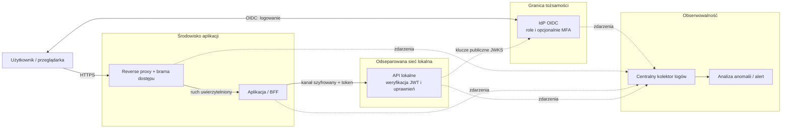

# M2: przegląd architektury i ryzyka

Materiał na spotkanie 27.11.2026. Jest propozycją do uzgodnienia przez zespół, a nie opisem wdrożonego systemu. Zakres i podział odpowiedzialności wynikają z [README](README.md).

## Architektura

Granice zaufania przebiegają między przeglądarką, usługą tożsamości, środowiskiem aplikacji, siecią lokalną i systemem logowania. Proxy ogranicza dostęp do aplikacji, ale API podejmuje własną decyzję na podstawie tokena. Sieć kontenerowa może pokazać segmentację w MVP, lecz sama nie stanowi dowodu bezpiecznego połączenia między rzeczywistą chmurą i siecią lokalną. Docelowy mechanizm kanału i miejsca zakończenia TLS wymagają decyzji zespołu.

## Proponowane kontrakty

- Role: `user` i `admin`; administrator ma także prawo odczytu. Proponowany claim: `roles` jako tablica w access tokenie przeznaczonym dla API. Konfiguracja IdP musi rzeczywiście go wystawiać.
- API: `GET /api/data` dla obu ról; `POST /api/admin/action` tylko dla `admin`. Brak, uszkodzenie lub wygaśnięcie tokena skutkuje 401; poprawny token bez wymaganego uprawnienia — 403.
- JWT: API sprawdza podpis przy użyciu zaufanego JWKS, dopuszczalny algorytm, `iss`, `aud`, `exp` i ewentualnie `nbf`, a następnie rolę. Wartości issuer i audience oraz sposób rotacji kluczy należy uzgodnić.
- Zdarzenie JSON: `timestamp` (UTC, ISO 8601), `service`, `event_type`, `user_id` (pseudonim lub null), `role`, `source_ip`, `endpoint`, `status_code`, `request_id`. Nie zapisywać haseł, pełnych tokenów ani sekretów; dostęp do logów i okres retencji wymagają ustalenia.
- `request_id` powstaje na zaufanej granicy wejścia lub jest tam walidowany; aplikacja przekazuje go dalej. Nie jest dowodem tożsamości.

## Przepływ danych

1. Użytkownik otwiera aplikację przez HTTPS. Brama kieruje nieuwierzytelnionego użytkownika do IdP.
2. IdP uwierzytelnia użytkownika, opcjonalnie z MFA. Przepływ OIDC Authorization Code z PKCE kończy się ustanowieniem sesji. Przy wzorcu BFF tokeny pozostają po stronie serwera, a przeglądarka otrzymuje ciasteczko sesyjne `HttpOnly`, `Secure` i `SameSite`.
3. Żądanie użytkownika przechodzi przez proxy do aplikacji. Aplikacja przekazuje do API przeznaczony dla niego access token i `request_id` przez szyfrowany kanał. Sposób pozyskania tokena o właściwym `aud` trzeba potwierdzić w konfiguracji IdP.
4. API niezależnie weryfikuje token i rolę, wykonuje dozwoloną operację albo zwraca 401/403. Wynik wraca do interfejsu, który prezentuje użytkownikowi odpowiedni komunikat.
5. IdP, proxy, aplikacja i API wysyłają zdarzenia do kolektora. Moduł analityczny wykrywa podejrzane wzorce i generuje alert; logowanie nie powinno zawierać danych uwierzytelniających.

## Model zagrożeń

Chronione zasoby: konta i sesje, dane biznesowe, operacje administracyjne, sekrety i klucze, dostęp do API oraz wiarygodność logów. Zakładamy zarówno nieuprawnionego użytkownika z Internetu, jak i użytkownika z legalnym kontem podstawowym.

| Zagrożenie | Skutek | Ograniczenie ryzyka | Weryfikacja / otwarta kwestia |
| --- | --- | --- | --- |
| Kradzież hasła lub sesji | Przejęcie konta | MFA, krótkie sesje, bezpieczne ciasteczka, TLS | Test wygaśnięcia i wylogowania; ustalić dostępność MFA |
| Zmieniony, wygasły lub błędnie adresowany token | Podszycie się pod użytkownika | Niezależna walidacja JWT w API, w tym issuer i audience | Testy 401 dla zmienionego, wygasłego i błędnego `aud` |
| Konto `user` wywołuje akcję administracyjną | Nieuprawniona zmiana | Kontrola roli w API, zasada najmniejszych uprawnień | Test 403; test pozytywny dla `admin` |
| Ominięcie bramy lub tunelu | Nieautoryzowany dostęp do usługi | Segmentacja, ograniczenie źródeł i portów, szyfrowany kanał | Próba bezpośredniego połączenia spoza dozwolonej sieci; potwierdzić topologię |
| Przechwycenie lub ujawnienie sekretu | Podszycie się pod komponent | Sekrety poza repozytorium, ograniczone uprawnienia, rotacja | Przegląd konfiguracji i historii; ustalić mechanizm przechowywania |
| Wyciek danych przez logi | Ujawnienie danych osobowych lub tokenów | Minimalizacja i maskowanie, kontrola dostępu i retencja | Przejrzeć próbkę logów; ustalić okres przechowywania |
| Modyfikacja lub utrata logów | Utrata dowodów i alertów | Ograniczyć zapis i dostęp, zabezpieczyć transport, monitorować kolektor | Ustalić mechanizm integralności i zachowanie przy awarii |
| Fałszywy lub przeoczony alert | Niepotrzebna reakcja albo brak reakcji | Dane testowe, próg i przegląd wyników, reguła demonstracyjna | Pokazać alert i przypadek normalny; określić ograniczenia modelu |

## Backlog MVP

Priorytet P0 oznacza wymaganie odbioru, P1 rozszerzenie zależne od możliwości środowiska. Szacunki i terminy należy ustalić po wyborze technologii.

| ID | Zadanie i kryterium ukończenia | Osoba | Priorytet / zależności |
| --- | --- | --- | --- |
| B01 | Zatwierdzić role, claim, issuer, audience, endpointy i schemat logu; zapisać decyzje | 1–5 | P0; przed integracją |
| B02 | Skonfigurować IdP, dwa konta i role; potwierdzić zawartość tokena | 1 | P0; B01 |
| B03 | Udostępnić aplikację przez HTTPS i bramę OIDC; dostęp bez sesji wymaga logowania | 1 | P0; B02 |
| B04 | Zaimplementować interfejs i sesję BFF, obsługę 401/403 oraz `request_id` | 2 | P0; B01–B03 |
| B05 | Zaimplementować oba endpointy i niezależną walidację JWT oraz ról | 3 | P0; B01–B02 |
| B06 | Skonfigurować szyfrowany kanał i segmentację API; udokumentować granice demonstracji | 3 | P0; B05 |
| B07 | Zebrać zdarzenia czterech komponentów w jednym formacie bez sekretów | 4 | P0; B01, integracja B02–B05 |
| B08 | Wykrywać anomalie na danych testowych i pokazać czytelny alert | 4 | P0; B07 lub dane przykładowe |
| B09 | Przygotować powtarzalne uruchomienie, konfigurację i instrukcję sekretów | 5 | P0; współpraca 1–4 |
| B10 | Uruchomić testy obu ról, 401, 403 i segmentacji; zebrać dowody i raport | 5 | P0; B03–B09 |
| B11 | Włączyć i sprawdzić MFA oraz procedurę odzyskania dostępu | 1 | P1; B02 i możliwości IdP |

## Decyzje na spotkanie

1. Wybrać IdP, proxy, sposób obsługi sesji i sposób uzyskania tokena dla API; potwierdzić proponowane kontrakty.
2. Ustalić środowiska demonstracji, mechanizm kanału hybrydowego, reguły sieciowe i sposób potwierdzenia segmentacji.
3. Wybrać kolektor, metodę analizy i kanał alertowania; ustalić retencję i dostęp do logów.
4. Wyznaczyć właścicieli zadań, terminy i miejsce przechowywania dowodów. MFA pozostaje zależne od możliwości środowiska.
